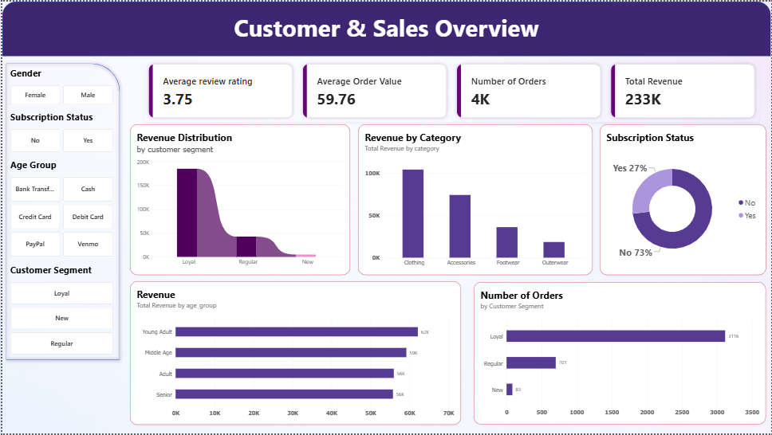
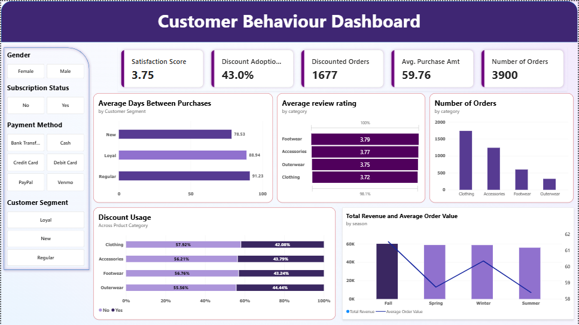

# Consumer Shopping Behavior & Sales Performance Analysis

**Business Intelligence | Customer Analytics | Sales Performance | Promotional Effectiveness**

A Business Intelligence project analysing retail transactions to evaluate sales performance, customer purchasing patterns, promotional effectiveness, product category performance, and customer experience.

Using Python, MySQL, and Power BI, this project transforms transactional data into actionable business intelligence, identifying opportunities to improve promotional efficiency, understand customer segments, and support more informed commercial decisions.

---

## 1. Business Problem

Retail businesses need a clear understanding of what drives purchasing behaviour, how customers respond to promotional incentives, and which product categories contribute most to sales performance.

However, transaction data alone does not provide these answers. Without structured analysis, businesses may continue allocating promotional incentives inefficiently, overlook differences in customer purchasing patterns, and make commercial decisions without sufficient insight into product and customer performance.

This project addresses a central business question:

**How can transaction-level customer data be used to identify opportunities to improve sales performance, optimise promotional strategies, and strengthen customer engagement?**

To address this, the analysis examines customer demographics, purchasing patterns, product performance, discount adoption, shipping preferences, seasonality, and customer satisfaction.

### Business Objectives

The analysis was structured around five business objectives:

1. **Evaluate Sales Performance:** Understand order volume, average order value, and product category contributions to overall sales.

2. **Understand Customer Behaviour:** Identify purchasing patterns across customer segments, age groups, gender, subscription status, and previous purchase activity.

3. **Assess Promotional Effectiveness:** Examine discount adoption and compare purchasing outcomes between discounted and non-discounted transactions.

4. **Evaluate Operational and Seasonal Patterns:** Investigate shipping preferences, seasonal demand, and their relationship with transaction value.

5. **Assess Customer Experience:** Examine review ratings and identify potential areas for improvement in customer satisfaction.

---

## 2. Analytical Questions

The business objectives were translated into specific analytical questions to guide the investigation.

| Business Area | Key Questions |
|---|---|
| Sales Performance | Which product categories generate the highest order volumes and average order values? |
| Customer Behaviour | How do purchasing patterns differ across customer demographics and customer segments? |
| Customer Loyalty | What proportion of orders comes from customers classified as loyal? |
| Promotional Effectiveness | How does discount adoption vary across product categories and customer segments? |
| Revenue Performance | How does average order value differ between discounted and non-discounted transactions? |
| Shipping | How do shipping preferences relate to order value and purchasing behaviour? |
| Seasonality | How does purchasing activity vary across seasons and product categories? |
| Customer Experience | What do customer review ratings indicate about the overall shopping experience? |

These questions provided the analytical direction for the project and ensured that the investigation remained focused on business outcomes rather than simply exploring available variables.

---

## 3. Dataset Overview

The analysis uses a consumer shopping behaviour dataset containing **3,900 retail transactions**.

The dataset includes information relating to:

| Data Category | Attributes |
|---|---|
| Transaction Information | Customer ID, purchase amount, previous purchases |
| Customer Demographics | Age, gender |
| Product Information | Item purchased, category, size, colour |
| Promotional Information | Discount applied, promotional code |
| Customer Behaviour | Subscription status, purchase frequency, customer segment |
| Transaction Preferences | Payment method, shipping type |
| Customer Experience | Review ratings |
| Time-Based Attributes | Season |

**Dataset Characteristics**

- Total Records: 3,900
- Primary Analytical Unit: Transaction
- Unique Customer IDs: 3,900
- Data Format: CSV

**Important Data Consideration:** Each `customer_id` represents one transaction in this dataset. Therefore, the analysis treats the records as transactions rather than assuming they represent a complete customer purchase history. Metrics such as total orders and total unique customer IDs are consequently equivalent within this dataset.

---

## 4. Dashboard Preview

The Power BI dashboard provides an interactive reporting solution for analysing consumer shopping behaviour and sales performance.

It enables stakeholders to monitor key performance indicators, evaluate product category performance, explore customer purchasing patterns, and investigate promotional and operational trends.

The dashboard is structured to provide visibility into the following business areas:

- Sales and transaction performance.
- Customer demographics and purchasing behaviour.
- Product category performance.
- Discount adoption and promotional patterns.
- Shipping preferences and seasonal trends.
- Customer satisfaction.

### Dashboard Pages

**1. Customer & Sales Overview**

Provides a high-level view of transaction performance, customer segments, and key business indicators.



**2. Product & Promotional Performance**

Explores product category performance, purchasing patterns, and the relationship between discount adoption and average order value.


**3. Customer Demographics & Behaviour**

Provides insights into customer purchasing patterns across demographic segments, including age groups and gender.




---

## 5. Tools & Technologies

| Tool | Application |
|---|---|
| Python | Data ingestion, exploration, and preprocessing |
| Pandas & NumPy | Data manipulation and analysis |
| Matplotlib & Seaborn | Exploratory data visualisation |
| MySQL | Relational data storage and querying |
| SQL | Business metric calculations and analytical segmentation |
| Power BI | Interactive reporting and data visualisation |
| DAX | Business measures and calculated KPIs |
| Gamma | Business intelligence presentation |
| GitHub | Project documentation and version control |

---

## 6. Analytical Methodology

The project followed a structured end-to-end analytics workflow, moving from raw transactional data to business insights and recommendations.

### Phase 1: Data Ingestion and Exploration

**Objective:** Understand the dataset's structure, composition, and suitability for business analysis.

The raw CSV dataset was imported into Python using Pandas.

Initial exploration focused on:

- Understanding the dataset's dimensions and structure.
- Examining column names and data types.
- Assessing missing values and duplicate records.
- Reviewing categorical distributions.
- Identifying potential data quality issues.
- Understanding the relationships between available attributes.

This stage established the foundation for subsequent data preparation and analysis.

### Phase 2: Data Cleaning and Preparation

**Objective:** Improve data quality and establish a consistent dataset for analysis.

Data preparation activities included:

- Identifying and assessing missing values.
- Checking for duplicate records.
- Validating data types.
- Reviewing inconsistent categorical values.
- Checking data consistency across relevant attributes.
- Preparing the dataset for database integration.

The objective was to ensure that subsequent calculations and visualisations were based on a consistent and reliable dataset.

### Phase 3: SQL-Based Business Analysis

**Objective:** Translate business questions into measurable performance indicators and analytical queries.

The prepared dataset was loaded into MySQL for structured querying and analysis.

SQL was used to investigate:

- Transaction volume and purchasing patterns.
- Product category performance.
- Average Order Value (AOV).
- Customer segmentation and loyalty patterns.
- Discount adoption and promotional behaviour.
- Demographic purchasing differences.
- Shipping preferences.
- Seasonal purchasing trends.
- Customer satisfaction.

Aggregations, conditional logic, grouping, and other SQL operations were used to calculate business metrics and identify patterns across different dimensions.

### Phase 4: Power BI Development

**Objective:** Convert analytical results into an interactive reporting solution for business stakeholders.

Power BI was used to develop an interactive dashboard that provides visibility into the dataset's commercial and customer-related performance.

The reporting solution incorporates:

- Sales and transaction KPIs.
- Product category performance.
- Customer segmentation.
- Demographic analysis.
- Promotional and discount analysis.
- Shipping analysis.
- Seasonal purchasing patterns.
- Customer satisfaction metrics.
- Interactive filters for multidimensional exploration.

DAX measures were developed to support KPI calculations and comparative analysis.

The dashboard enables stakeholders to move beyond high-level performance figures and investigate the underlying patterns across different business dimensions.

### Phase 5: Business Intelligence Reporting

**Objective:** Translate analytical findings into business implications and actionable recommendations.

The final analysis was consolidated into a Business Intelligence Performance Report.

The report focuses on:

- Key analytical findings.
- Commercial implications of observed patterns.
- Promotional efficiency.
- Customer purchasing behaviour.
- Product category performance.
- Opportunities for operational and commercial improvement.
- Data limitations and opportunities for further investigation.

### Phase 6: Business Presentation

The findings were summarised into a stakeholder-oriented presentation using Gamma.

The presentation communicates the business problem, analytical approach, significant findings, and recommended actions in a concise and accessible format.

---

## 7. Key Performance Indicators

The analysis established the following performance indicators:

| KPI | Result |
|---|---:|
| Total Orders | 3,900 |
| Average Review Rating | 3.76 / 5 |
| Loyal Customer Orders | 3,116 |
| Loyal Order Share | 80% |
| Highest-Volume Product Category | Clothing |
| Clothing Orders | 1,737 |
| Free Shipping Orders | 675 |
| Free Shipping Revenue | $40,777 |
| Free Shipping AOV | $60.41 |

These indicators provide a high-level overview of transaction volume, customer segmentation, product performance, and shipping behaviour.

---

## 8. Key Business Findings

The analysis revealed several patterns with implications for commercial performance and customer engagement.

### 8.1 Customer Loyalty and Purchasing Behaviour

Customers classified as loyal accounted for 3,116 transactions, representing approximately 80% of total orders.

This indicates that the dataset's transaction volume is heavily concentrated within the loyal customer segment.

**Business Implication:**

Customer retention and engagement strategies should remain important commercial priorities. However, the business should also investigate opportunities to convert less-engaged customers into repeat purchasers.

### 8.2 Product Category Performance

Clothing recorded the highest transaction volume, with 1,737 orders, followed by Accessories with 1,240 orders.

Together, these categories accounted for more than 76% of all transactions.

Average Order Value also varied across product categories, ranging from approximately $57.17 for Outerwear to $60.25 for Footwear.

**Business Implication:**

Product category performance should be evaluated using both transaction volume and order value. High transaction volume does not necessarily translate into the highest average transaction value.

### 8.3 Promotional Effectiveness

Discount adoption exceeded 40% across the dataset.

However, comparing average order values between discounted and non-discounted transactions revealed different outcomes across product categories.

| Product Category | Discounted AOV | Non-Discounted AOV | Difference |
|---|---:|---:|---:|
| Footwear | $61.80 | $59.08 | +$2.72 |
| Clothing | $59.75 | $60.22 | -$0.47 |
| Accessories | $58.49 | $60.89 | -$2.40 |
| Outerwear | $55.32 | $58.66 | -$3.34 |

Footwear recorded a higher AOV among discounted transactions, while Accessories and Outerwear recorded lower AOVs.

**Business Implication:**

Promotional strategies should be evaluated at the product category level rather than applied uniformly across the product portfolio.

The observed differences warrant further investigation to determine whether discounts are associated with meaningful improvements in purchasing outcomes.

### 8.4 Demographic Purchasing Patterns

Purchasing activity varied across age groups and gender segments.

The analysis also identified that female customers had no recorded discounted transactions in the dataset.

**Business Implication:**

The absence of recorded discounts among female customers presents an opportunity to investigate differences in promotional exposure, purchasing preferences, and product mix.

Further investigation would be necessary before drawing conclusions about the underlying reasons.

### 8.5 Shipping and Order Value

Free Shipping accounted for 675 transactions, generating approximately $40,777 in revenue, with an average order value of $60.41.

The analysis also identified differences in average order value across shipping methods.

**Business Implication:**

Shipping incentives may provide an opportunity to influence basket value and purchasing decisions.

However, their commercial effectiveness should be evaluated alongside shipping costs, contribution margins, and potential changes in conversion rates.

### 8.6 Customer Satisfaction

The overall average review rating was 3.76 out of 5.

**Business Implication:**

Customer satisfaction should be monitored alongside commercial performance indicators.

Further investigation into ratings by product category, season, and customer segment could help identify areas where the shopping experience requires improvement.

---

## 9. Business Recommendations

Based on the analytical findings, the following actions are recommended.

| Priority | Recommendation | Expected Business Value |
|---|---|---|
| High | Review discount allocation across product categories, particularly Accessories and Outerwear. | Reduce potentially inefficient promotional spending. |
| High | Introduce and test threshold-based promotional incentives, such as discounts on qualifying basket values. | Encourage higher basket values while controlling discount exposure. |
| High | Investigate the absence of discounted transactions among female customers. | Improve understanding of promotional reach and customer engagement. |
| Medium | Develop targeted customer retention and engagement strategies. | Strengthen customer relationships and encourage repeat purchasing. |
| Medium | Evaluate shipping incentives against fulfilment costs and order value. | Improve the commercial efficiency of shipping promotions. |
| Medium | Monitor product category performance using both order volume and AOV. | Support better inventory, merchandising, and sales decisions. |
| Medium | Investigate customer satisfaction across product and demographic segments. | Identify opportunities to improve customer experience. |

### Further Analytical Opportunities

The available dataset provides a foundation for additional analysis.

Future work could explore:

- Customer Lifetime Value (CLV).
- Customer retention and cohort analysis.
- Purchase frequency and repeat purchase behaviour.
- Product profitability and contribution margin.
- Promotional campaign effectiveness.
- Basket analysis and product affinity.
- Statistical testing of promotional performance.
- A/B testing of alternative discount strategies.

These analyses would provide additional evidence for evaluating long-term customer value and commercial profitability.

---

## 10. Analytical Limitations

A number of limitations should be considered when interpreting the findings.

1. **Transaction-Level Data:** Each customer ID represents one transaction. Consequently, the dataset does not provide a complete longitudinal view of individual customer purchasing behaviour.

2. **Revenue vs. Profitability:** The analysis focuses primarily on transaction value and average order value. Product costs, operating expenses, and contribution margins are not available, so profitability cannot be established.

3. **Promotional Attribution:** Differences in AOV between discounted and non-discounted transactions do not establish that discounts caused changes in purchasing behaviour.

4. **Customer Satisfaction:** Review ratings provide an indication of customer experience but do not independently explain the factors influencing satisfaction.

5. **Shipping Effectiveness:** Shipping-related revenue and AOV do not establish the incremental financial benefit of free shipping without information about fulfilment costs and customer behaviour.

These limitations define the boundaries of the conclusions and highlight areas where additional data would strengthen future analysis.

---

## 11. Project Deliverables

The project produced the following deliverables:

| Deliverable | Description |
|---|---|
| Python Notebook | Data exploration, preprocessing, and exploratory analysis. |
| SQL Scripts | Business-focused queries and performance analysis. |
| Power BI Dashboard | Interactive reporting and performance monitoring. |
| Business Intelligence Report | Detailed findings, business implications, and recommendations. |
| Stakeholder Presentation | Executive-oriented summary of the analysis. |

---

## 12. Project Structure

```text
Consumer-Shopping-Behavior-Analysis/
│
├── data/
│   └── customer_behaviour_data.csv
│
├── python/
│   └── exploratory_data_analysis.ipynb
│
├── sql/
│   └── analysis_queries.sql
│
├── powerbi/
│   └── consumer_shopping_behavior.pbix
│
├── report/
│   └── business_intelligence_report.pdf
│
├── presentation/
│   └── consumer_shopping_behavior.pptx
│
└── README.md
```

---

## 13. How to Reproduce the Analysis

### Prerequisites

- Python 3.x
- Jupyter Notebook
- MySQL Server and MySQL Workbench
- Power BI Desktop

### Step 1: Set Up Python

Install the required Python libraries:

```bash
pip install pandas numpy matplotlib seaborn jupyter
```

Navigate to the `python/` directory and open the Jupyter Notebook.

Run the notebook to perform data exploration, preprocessing, and exploratory analysis.

### Step 2: Set Up MySQL

1. Create a MySQL database.
2. Import the prepared dataset.
3. Execute the SQL scripts in the `sql/` directory.
4. Review the analytical queries and resulting business metrics.

### Step 3: Open the Power BI Dashboard

1. Open the `.pbix` file using Power BI Desktop.
2. Configure the data source if required.
3. Refresh the dataset.
4. Explore the dashboard using the available filters and visualisations.

---

## 14. Skills Demonstrated

**Technical Skills**

Python | Pandas | NumPy | Exploratory Data Analysis | Data Cleaning | SQL | MySQL | Power BI | DAX | Data Modelling | Data Visualisation

**Business Intelligence & Analytical Skills**

Business Problem Definition | KPI Development | Customer Segmentation | Sales Performance Analysis | Promotional Effectiveness Analysis | Customer Behaviour Analysis | Commercial Performance Analysis | Data Storytelling | Business Reporting | Insight Generation | Data-Driven Recommendations

---

## Conclusion

This project demonstrates how transactional data can be transformed into business intelligence that supports commercial decision-making.

By examining customer purchasing patterns, product category performance, promotional behaviour, shipping preferences, and customer satisfaction, the analysis identifies opportunities to improve promotional allocation, strengthen customer engagement, and gain a better understanding of sales performance.

Beyond dashboard development, the project emphasises the importance of connecting analytical findings to business problems and translating data into practical recommendations.
